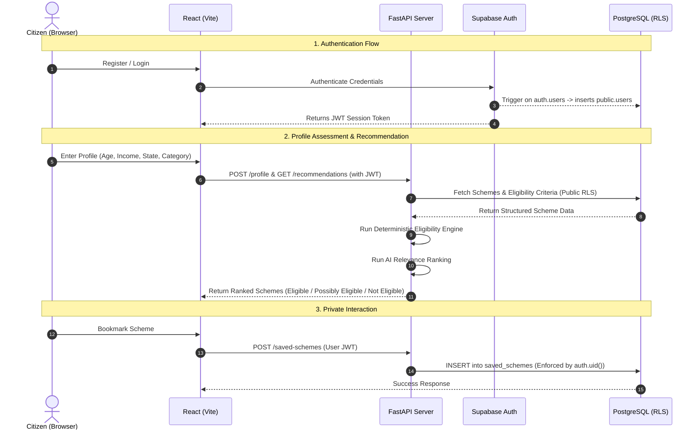

# System Architecture Overview

> **Phase:** 1 (Supabase Database + RLS Architecture)  
> **Target Deployment:** React Frontend, FastAPI Backend, Supabase Managed PostgreSQL

---

## 1. Core Architecture Flow

The AI Government Scheme Recommendation System strictly adheres to a multi-tiered architecture ensuring clear separation of concerns, data privacy, and deterministic reliability:

```
┌──────────────────────────────────────────────┐
│                    React                     │
│           (Citizen Web Portal)               │
└──────────────────────┬───────────────────────┘
                       │ HTTPS / REST / JSON
                       ▼
┌──────────────────────────────────────────────┐
│                   FastAPI                    │
│     (Async Python Backend / Rule Engine)     │
└──────────────────────┬───────────────────────┘
                       │ supabase-py / PostgREST
                       ▼
┌──────────────────────────────────────────────┐
│                  Supabase                    │
│       (Auth Engine & Managed Gateway)        │
└──────────────────────┬───────────────────────┘
                       │ Connection Pooler
                       ▼
┌──────────────────────────────────────────────┐
│                 PostgreSQL                   │
│       (12 Relational Tables + RLS)           │
└──────────────────────────────────────────────┘
```

---

## 2. Layer Responsibilities

### 1. React (Citizen Web Portal)
- **Role:** Interactive citizen frontend for discovering welfare schemes, tracking eligibility, receiving alerts, and chatting with the assistant.
- **Security:** Operates exclusively using client-safe public keys (`VITE_SUPABASE_URL`, `VITE_SUPABASE_PUBLISHABLE_KEY`). Never contains backend secrets, service role keys, or OpenAI API credentials.
- **Authentication:** Interacts with Supabase Auth for citizen login, registration, and session token storage.

### 2. FastAPI (Backend API & Intelligence Engine)
- **Role:** Central business orchestration layer.
- **Services:**
  - **Rule-Based Eligibility Engine:** Deterministic logic evaluating citizen profile criteria against scheme eligibility rules (`Eligible`, `Possibly Eligible`, `Not Eligible`).
  - **AI Relevance & Ranking Engine:** Uses OpenAI embeddings and models solely for semantic intent matching, relevance ranking, and natural language explanations. (The AI match score never alters legal eligibility).
  - **Data Ingestion Pipelines:** Ingests and verifies official Indian government scheme data (myScheme.gov.in standards).
- **Integration:** Communicates with Supabase using [`app/integrations/supabase_client.py`](file:///C:/Users/vishn/ai-gov-scheme-recommender/backend/app/integrations/supabase_client.py).

### 3. Supabase (Managed Gateway & Auth)
- **Role:** Handles user authentication, session verification, and API routing.
- **User Synchronization:** When a user registers via Supabase Auth, a database trigger automatically synchronizes their record into `public.users`.

### 4. PostgreSQL (Data Layer with RLS)
- **Role:** Relational persistence layer containing 12 normalized application tables.
- **Row Level Security (RLS):** All 12 tables have RLS enabled.
  - **Public reference tables** (`states`, `districts`, `scheme_categories`, `schemes`, `scheme_eligibility`, `scheme_documents`, `scheme_sources`) are publicly readable (`USING (true)`).
  - **Private citizen tables** (`users`, `user_profiles`, `saved_schemes`, `notifications`, `chat_history`) enforce strict owner isolation via `auth.uid() = user_id`.

---

## 3. Data Flow Diagram


