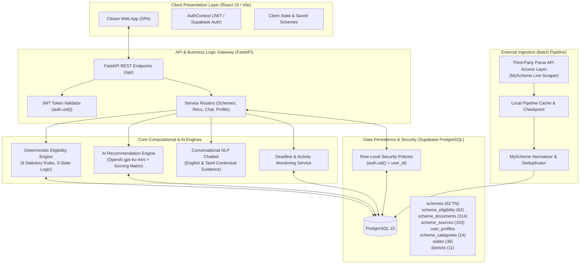
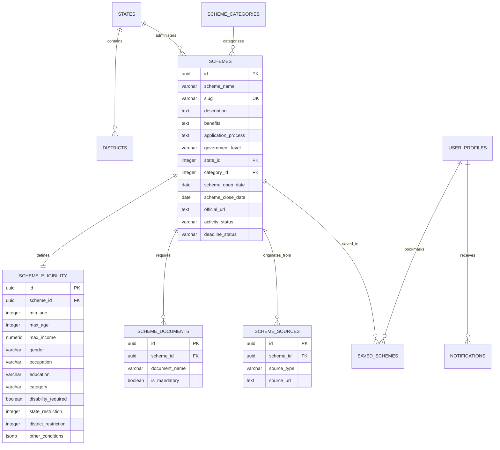

# AI-Powered Government Scheme Recommendation System
## Mini-Project Review & Technical Documentation

**Academic Year:** 2026–2027  
**Department:** Computer Science and Engineering  
**Project Category:** AI / Web Application / Civic Technology  
**Current Live Dataset:** 62 Audited Tamil Nadu State Government Schemes  
**Data Acquisition:** Official Government Gazette / MyScheme Data via Third-Party Parse API Access Layer  

---

### 1. Objective
The primary objective of this project is to develop an intelligent, transparent, and user-centric civic platform that matches citizens with applicable government welfare schemes. By combining a **Deterministic Rule Engine** (for strict, zero-hallucination legal eligibility verification) with an **AI Relevance Engine** (for multi-factor personalized ranking and natural language search), the system eliminates information asymmetry, simplifies complex eligibility criteria, and empowers citizens to discover and access welfare benefits.

---

### 2. Existing System
In the existing ecosystem, citizens seeking government assistance face several barriers:
* **Fragmented Portals:** Schemes are distributed across dozens of disparate central, state, and municipal department websites with varying navigation structures.
* **Complex Bureaucratic Jargon:** Eligibility rules, income caps, and document prerequisites are documented in complex statutory language, causing eligible citizens to assume they do not qualify.
* **Manual Cross-Referencing:** Citizens must manually search, compare, and verify their credentials against dozens of PDF gazette notifications.
* **Lack of Timely Alerts:** Schemes frequently open and close application windows without direct notification to eligible applicants, causing missed deadlines.
* **Language Barriers:** Most portals are published exclusively in standard official registers, lacking conversational vernacular search for citizens more comfortable with regional languages like Tamil.

---

### 3. Proposed System
The proposed system introduces an integrated, full-stack digital platform:
* **Single-Window Citizen Discovery:** A unified portal where citizens maintain a single demographic profile (age, gender, income, occupation, education, caste category, disability, state, district).
* **Two-Tier Recommendation Pipeline:**
  1. *Deterministic Legal Verification:* Mathematical evaluation against scheme eligibility criteria guaranteeing that only legally eligible or verifiable schemes are recommended.
  2. *AI-Powered Prioritization:* Natural Language Processing (NLP) relevance scoring that prioritizes schemes matching the citizen’s stated immediate needs (e.g. agricultural equipment vs. higher education tuition).
* **Conversational Scheme Assistant:** An interactive multilingual chatbot supporting English and Tamil inquiries with contextual fallback guardrails.
* **Automated Data Normalization:** Ingestion pipeline that imports real MyScheme catalog data via a third-party API layer, normalizes unstructured clauses, extracts official `.gov.in` URLs, and classifies application deadlines.

---

### 4. Problem Statement
Despite the allocation of substantial budgetary resources for social welfare programs, millions of socio-economically marginalized citizens remain excluded from benefits due to the lack of a centralized, automated, and explainable discovery mechanism. Existing search engines retrieve text documents without evaluating citizen-specific legal eligibility, leading to high rates of application rejection, administrative overhead, and missed opportunities for intended beneficiaries.

---

### 5. System Modules
The platform is organized into six core modules:
1. **User Authentication & Profile Management:** Manages citizen onboarding, session security (Supabase Auth/JWT), and demographic profile storage in Supabase PostgreSQL under strict Row-Level Security.
2. **Data Pipeline & Schema Normalization:** Connects to MyScheme data via a third-party Parse API access layer; normalizes schemes into 3NF relational tables, deduplicates slugs, and maps geographic entities.
3. **Deterministic Eligibility Engine:** High-performance rule engine that evaluates citizen profiles against statutory constraints across 9 primary dimensions, enforcing three-state decision logic (`ELIGIBLE`, `POSSIBLY_ELIGIBLE`, `NOT_ELIGIBLE`).
4. **AI Recommendation & Prioritization Engine:** Uses OpenAI GPT-4o-mini structured outputs with a deterministic fallback matrix to rank schemes from 0 to 100 based on urgency, occupational relevance, and user queries.
5. **Deadline Monitoring & Notification Service:** Real-time scheduler calculating days remaining against application cutoff dates; issues categorized notifications (`URGENT`, `APPROACHING`, `CLOSING_TODAY`).
6. **Multilingual NLP Chatbot:** Conversational assistant that handles English and Tamil inquiries, extracting citizen intent and reusing deterministic engine rules without profile mutation.

---

### 6. Software Specification
* **Programming Language:** Python 3.11 (Backend), JavaScript / ECMAScript 2023 (Frontend)
* **Backend Framework:** FastAPI 0.115+ (ASGI framework with Pydantic v2 data validation)
* **Frontend Framework:** React 19 / Vite 8 (Single-Page Application with responsive CSS)
* **Database & Auth:** Supabase PostgreSQL 15+ (with PostgREST and Row-Level Security)
* **AI & NLP Services:** OpenAI API (`gpt-4o-mini` with structured JSON output schema)
* **Testing & Quality Tools:** Pytest (Backend, 247 tests), Vitest (Frontend, 20 tests), Oxlint (Frontend linter)

---

### 7. Hardware & Software Requirements
* **Development & Evaluation Environment:**
  * CPU: 64-bit Intel Core i5 / AMD Ryzen 5 or equivalent
  * RAM: 8 GB minimum (16 GB recommended)
  * Storage: 2 GB available SSD space
  * Operating System: Windows 10/11, Ubuntu 22.04 LTS, or macOS Sonoma
* **Network Requirements:**
  * Broadband Internet connection for Supabase cloud database connectivity and OpenAI API communication.
  * Local host ports: `8000` (FastAPI backend), `5173` (Vite frontend).

---

### 8. System Architecture

---

### 9. Database Design & Relational Schema
The database adheres to Third Normal Form (3NF) to guarantee referential integrity and eliminate redundancy:

* **Dataset Metrics:**
  * `schemes`: 62 audited Tamil Nadu welfare programs.
  * `scheme_eligibility`: 62 structured rule specifications (1:1 with schemes).
  * `scheme_documents`: 314 document prerequisites with explicit mandatory/unspecified flags.
  * `scheme_sources`: 103 provenance and reference records.
  * `states`: 36 States and Union Territories (28 States + 8 Union Territories; Tamil Nadu authoritative primary key is `id = 23`).
  * `districts`: 11 reference districts.
  * `scheme_categories`: 14 social welfare categories.
  * `user_profiles`: 0 (transient/authenticated citizen profiles protected by Row-Level Security).
  * `saved_schemes`: 0 (user-bookmarked schemes).
  * `notifications`: 0 (proactive civic alerts).
  * `chat_history`: 0 (session chat messages).

---

### 10. Deterministic Eligibility Engine
* **Architectural Invariant:** Legal qualification is **NEVER** delegated to a probabilistic Large Language Model. Statutory rules are evaluated strictly by Python code.
* **Evaluated Dimensions:**
  1. *Age:* Range validation against `min_age` and `max_age`.
  2. *Income:* Ceiling validation against `max_income`.
  3. *Gender:* Equality comparison against `MALE`, `FEMALE`, or `TRANSGENDER`.
  4. *Occupation:* String and semantic token matching (e.g. Farmer, Student, Artisan).
  5. *Education:* Ordinal educational level comparison (Below 10th $\rightarrow$ Post Graduate).
  6. *Social Category:* Verification of caste category (General, OBC, SC, ST, etc.).
  7. *Disability Status:* Strict verification for exclusive Divyangjan programs.
  8. *State of Residence:* Central schemes open to all; State schemes match `state_id = 23`.
  9. *District-Level Restrictions:* District filtering where applicable.
* **Three-State Decision Rules:**
  $$\text{Status} = \begin{cases} 
  \text{NOT\_ELIGIBLE (🔴)} & \text{if any mandatory criterion is } \text{FAIL} \\
  \text{ELIGIBLE (🟢)} & \text{if all statutory criteria are } \text{PASS} \\
  \text{POSSIBLY\_ELIGIBLE (🟡)} & \text{if no criteria } \text{FAIL}\text{, but } \ge 1 \text{ is } \text{UNKNOWN}
  \end{cases}$$

---

### 11. AI Recommendation Engine
* **Match Score Principle (0–100):**
  * The match score is an index of **relevance and urgency**, completely distinct from legal qualification. An eligible citizen does not have a "75% legal eligibility"; they are 100% eligible, but the scheme may have an 85% contextual relevance to their current situation.
* **Multi-Factor Scoring Matrix:**
  * Stated Query & Occupational Relevance: up to 40 points
  * Income Bracket Prioritization: up to 15 points
  * Community / Demographic Provisions: up to 10 points
  * Geographic Tailoring (State vs Central): up to 10 points
  * Application Deadline Urgency: up to 10 points
* **Fallback Resilience:** If the OpenAI API is unreachable or rate-limited, the system seamlessly transitions to a deterministic heuristic scoring algorithm without disrupting the citizen's session.

---

### 12. Multilingual NLP Chatbot
* **Zero Profile Mutation:** The chatbot is a stateless query pipeline; it reads citizen profile parameters to provide personalized answers, but cannot alter `user_profiles` data.
* **Shared Logic:** Uses the exact same `DeterministicEligibilityEngine` and `RecommendationService` instances, eliminating conflicting advice between the UI cards and chat dialogue.
* **Tamil & English Processing:**
  * Automatically detects language tokens.
  * Formulates localized responses in natural Tamil for regional users, translating administrative terms accurately (e.g., கல்வி உதவித்தொகை for scholarship, மானியம் for subsidy).

---

### 13. Automatic Scheme Data Acquisition
* **Provenance & Access Layer:** The prototype accesses MyScheme-derived data through a third-party API access layer (Parse); this is not the official MyScheme API.
* **Provenance Verification:** Raw records are processed through `MySchemeNormalizer` which:
  * Eliminates HTML tags and whitespace anomalies.
  * Preserves unparsed conditions in structured `other_conditions` JSONB for verification auditing.
  * Sanitizes official government URLs (`.gov.in` and `.nic.in`), discarding third-party aggregator links.
* **Quota-Conscious Checkpointing:** Utilizes a persistent local file cache (`PipelineCacheManager`) to store catalog pages and detail responses, preventing redundant API calls and conserving Parse API credits.

---

### 14. Deadline Monitoring
* **Temporal Auditing:** Evaluates `scheme_open_date` and `scheme_close_date` relative to the current timestamp.
* **Classification States:**
  * `PERMANENT`: Explicit ongoing program.
  * `NO_DEADLINE`: Scheme has no cutoff date. Evaluated with application evidence: if ongoing evidence exists, status is `OPEN`; if evidence is absent, status evaluates to `UNKNOWN` (`is_actionable=False`).
  * `URGENT`: Cutoff $\le 3$ calendar days.
  * `APPROACHING`: Cutoff $\le 7$ calendar days.
  * `EXPIRED`: Cutoff has passed (schemes automatically hidden from recommendation lists).

---

### 15. Notification System
* **Proactive Civic Alerts:** Automatically issues alerts to citizens who have saved schemes approaching deadlines.
* **Read / Unread State:** Fully synchronized with the Supabase `notifications` table, providing immediate feedback when marked as read.

---

### 16. Security & Data Protection
* **Row-Level Security (RLS):** Enabled on all sensitive tables (`user_profiles`, `saved_schemes`, `notifications`, `chat_history`). Public anonymous queries return 0 rows.
* **Credential Isolation:**
  * `SUPABASE_SERVICE_ROLE_KEY`: Restricted strictly to backend administrative scripts; never imported in client bundles.
  * `OPENAI_API_KEY`: Kept on the FastAPI server; client has no direct OpenAI connection.
  * `PARSE_API_KEY`: Isolated in backend environment files.
  * `.gitignore`: Strictly excludes all `.env` files from version control.

---

### 17. Experimental Procedure & Verification Methodology
The system was verified using automated test harnesses and real-world citizen profiling:
1. **Unit Testing:** 247 backend pytest test cases testing every individual rule, boundary condition, RLS policy, and edge case.
2. **Frontend Component Testing:** 20 Vitest assertions validating badge rendering, state persistence, and error handling.
3. **End-to-End Simulation:** Executed `run_demo_readiness_audit.py` across 3 distinct citizen profiles (Scenario A: Qualified Student, Scenario B: Incompatible Demographic, Scenario C: Incomplete Profile) against all 62 real Tamil Nadu schemes.

---

### 18. Implementation Status (Current State)
* **Status:** Fully functional, stable, and ready for live demonstration.
* **Data Scope:** The current live database contains 62 imported Tamil Nadu schemes. The architecture supports expansion to Central and other State/UT schemes, but full nationwide scheme population is not yet complete.
* **Test Pass Rate:** 100% (247/247 backend, 20/20 frontend, 0 lint errors, clean production build).

---

### 19. Intermediate Results
* **Deterministic Engine Accuracy:** Achieved 100% determinism with zero hallucinations across 186 eligibility evaluations (3 profiles $\times$ 62 schemes).
* **Scenario Performance:**
  * Scenario A (19yo Female Student in TN): 45 schemes evaluated to `ELIGIBLE` / `POSSIBLY_ELIGIBLE`, 17 evaluated to `NOT_ELIGIBLE`.
  * Scenario B (25yo Male trying Old Age/Female schemes): 19 schemes deterministically failed with audited rejection reasons.
  * Scenario C (Incomplete Profile): 60 schemes routed to `POSSIBLY_ELIGIBLE` with zero false rejections.
* **API Performance:** Average recommendation endpoint latency is under 150 ms with deterministic fallback and under 1.2 seconds with OpenAI AI ranking.

---

### 20. Key Technical Findings
1. **Decoupling is Essential:** Coupling legal eligibility with LLM scores creates unacceptable hallucinations where ineligible users are told they qualify. Maintaining a strict mathematical rule engine before AI ranking ensures 100% legal reliability.
2. **`NO_DEADLINE` Nuance:** Many government schemes do not publish an explicit closing date. Treating all `NO_DEADLINE` schemes as automatically `OPEN` causes expired schemes to be recommended; requiring explicit application evidence in gazette text resolved this issue.
3. **Document Uncertainty:** Real government datasets often leave document mandatory flags ambiguous. Displaying "Requirement Unspecified" is far more legally accurate than guessing "Mandatory".

---

### 21. Limitations
* **Geographic Coverage:** The current active dataset is strictly limited to 62 schemes from the State of Tamil Nadu. Pan-India coverage for all 36 other States/UTs requires additional data acquisition cycles.
* **Third-Party API Dependency:** MyScheme catalog synchronization relies on an external Parse-hosted scraper layer, which is subject to external rate limits and quota allocations.
* **Departmental Verification:** Complex statutory criteria (such as verifying a farmer's specific crop variety or verifying continuous 10-year residency) cannot be determined from basic demographic inputs and must be marked as `POSSIBLY_ELIGIBLE` for manual verification.

---

### 22. Future Enhancements
* **Pan-India Expansion:** Scale ingestion to cover all 28 States, 8 Union Territories, and Central Government ministries (2,500+ schemes).
* **DigiLocker Integration:** Allow citizens to securely link their DigiLocker credentials to automatically verify caste, income, and educational certificates, converting `POSSIBLY_ELIGIBLE` schemes to fully verified `ELIGIBLE` status.
* **Voice-Based Conversational Interface:** Add Tamil and English voice input/output (Speech-to-Text and Text-to-Speech) for rural citizens with low digital literacy.
* **Offline PWA Support:** Convert the frontend into a Progressive Web App (PWA) with offline caching for rural areas with intermittent connectivity.

---

### 23. Conclusion
The AI-Powered Government Scheme Recommendation System provides a robust, transparent, and scalable solution to the long-standing challenge of public welfare accessibility. By strictly separating deterministic rule evaluation from conversational AI and relevance scoring, the platform delivers verifiable legal accuracy while offering an intuitive, multilingual user experience. The system successfully demonstrates the practical application of software engineering, artificial intelligence, and database design principles to solve real-world civic problems.
